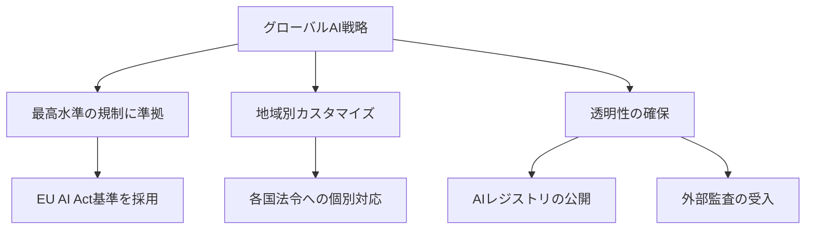

## はじめに：なぜ今、AI規制を理解すべきなのか

2024年8月、EU AI Act（人工知能規制法）が正式に施行されました。これはAIシステムに対する世界初の包括的な法的枠組みであり、GDPRと同様に域外適用される可能性があるため、**日本の企業や開発者も無関係ではいられません**。

この記事では、技術者の視点からEU AI Actの要点を解説し、実際の開発現場でどのような対応が求められるのか、具体的なアクションプランまで踏み込んで説明します。

**この記事で得られること：**
- EU AI Actの基本的な仕組みとリスク分類
- 開発者が注意すべき具体的なポイント
- コンプライアンス対応の実践的アプローチ
- 今後のグローバル展開における戦略のヒント

## EU AI Actの基本構造：リスクベースアプローチ

EU AI Actの最大の特徴は、**リスクベースアプローチ**を採用している点です。AIシステムを4つのリスクレベルに分類し、それぞれに異なる規制を適用します。

### 4つのリスク分類

#### 1. 許容できないリスク（禁止）
以下のようなAIシステムは原則として禁止されます：

- **社会的スコアリングシステム**：中国の信用スコアのような、個人の社会的行動を総合的に評価するシステム
- **リアルタイム生体認証**：公共空間での法執行目的の顔認証（例外あり）
- **サブリミナル操作**：ユーザーの意識下で行動を操作するシステム
- **脆弱性の悪用**：年齢、障害、社会経済的状況などの脆弱性を利用するシステム

```python
# 禁止される可能性のある実装例（イメージ）
class SocialScoringSystem:
    def calculate_citizen_score(self, person):
        # SNS活動、購買履歴、交友関係などから総合スコアを算出
        # → EU AI Actでは原則禁止
        score = self.analyze_social_media(person)
        score += self.analyze_financial_behavior(person)
        score += self.analyze_social_connections(person)
        return score
```

#### 2. 高リスク
人の安全や基本的権利に重大な影響を与える可能性のあるシステム：

- **採用・人事評価AI**
- **信用スコアリング（金融）**
- **教育現場での評価システム**
- **法執行機関のツール**
- **重要インフラの管理システム**
- **医療診断支援システム**

これらには厳格な要件が課されます（後述）。

#### 3. 限定的リスク
透明性義務のみが課されるシステム：

- **チャットボット**：AIとの対話であることを明示する必要がある
- **ディープフェイク**：生成されたコンテンツであることを表示する義務
- **感情認識システム**：使用していることをユーザーに通知

```javascript
// チャットボットの透明性要件の実装例
function initializeChatbot() {
  displayDisclosure({
    message: "このチャットボットはAIによって運営されています。",
    type: "AI_DISCLOSURE",
    persistent: true
  });
  
  // ユーザーの同意を取得
  awaitUserConsent();
}
```

#### 4. 最小限のリスク
規制対象外（スパムフィルター、ゲームのAIなど）

## 高リスクAIシステムに求められる具体的要件

開発者が最も注意すべきは「高リスク」カテゴリです。以下の要件を満たす必要があります。

### 1. リスク管理システムの構築

継続的なリスク評価と管理のプロセスが必須です。

```python
class AIRiskManagementSystem:
    def __init__(self, ai_system):
        self.ai_system = ai_system
        self.risk_log = []
        
    def assess_risks(self):
        """定期的なリスク評価"""
        risks = {
            'bias_risk': self.evaluate_bias(),
            'security_risk': self.evaluate_security(),
            'performance_risk': self.evaluate_performance(),
            'data_quality_risk': self.evaluate_data_quality()
        }
        self.risk_log.append({
            'timestamp': datetime.now(),
            'risks': risks
        })
        return risks
    
    def evaluate_bias(self):
        """バイアス評価の実装"""
        # 保護属性（性別、人種等）による性能差異を測定
        performance_by_group = self.ai_system.test_by_demographic()
        
        # 統計的パリティの確認
        disparity = self.calculate_disparity(performance_by_group)
        
        return {
            'level': 'high' if disparity > 0.1 else 'acceptable',
            'details': performance_by_group
        }
```

### 2. データガバナンスの確立

訓練データの品質管理が重要です：

- **代表性**：訓練データが実際の使用環境を代表しているか
- **バイアスチェック**：保護属性に関する偏りがないか
- **データの出所**：データの収集方法と使用権限が適切か

```yaml
# データガバナンス設定ファイルの例
data_governance:
  training_data:
    source: "公開データセット XYZ v2.1"
    collection_date: "2024-01-15"
    demographic_distribution:
      gender:
        male: 48%
        female: 51%
        other: 1%
      age_groups:
        18-30: 25%
        31-50: 45%
        51+: 30%
    bias_assessment:
      last_check: "2024-07-01"
      status: "approved"
      disparate_impact_ratio: 0.92
  validation_data:
    source: "内部収集データ"
    consent_obtained: true
    anonymization: "k-anonymity (k=5)"
```

### 3. 技術文書の作成と保管

AIシステムの設計、開発、テストに関する包括的な文書化が必要です：

- アーキテクチャ図
- 訓練プロセスの記録
- 性能評価結果
- バイアステスト結果
- リスク評価レポート

### 4. ログ記録と追跡可能性

```python
class ComplianceLogger:
    """EU AI Act準拠のログ記録システム"""
    
    def log_prediction(self, input_data, output, confidence, metadata):
        """個別の予測をログに記録"""
        log_entry = {
            'timestamp': datetime.utcnow().isoformat(),
            'model_version': metadata['model_version'],
            'input_hash': self.hash_input(input_data),  # 個人情報は含まない
            'output': output,
            'confidence': confidence,
            'processing_time_ms': metadata['processing_time'],
            'environmental_factors': {
                'server_load': metadata['server_load'],
                'concurrent_requests': metadata['concurrent_requests']
            }
        }
        
        # 長期保管（最低5年）
        self.store_to_audit_log(log_entry)
        
    def generate_audit_report(self, start_date, end_date):
        """監査用レポートの生成"""
        logs = self.retrieve_logs(start_date, end_date)
        
        return {
            'total_predictions': len(logs),
            'average_confidence': self.calculate_avg_confidence(logs),
            'error_rate': self.calculate_error_rate(logs),
            'demographic_performance': self.analyze_by_demographics(logs),
            'anomalies': self.detect_anomalies(logs)
        }
```

### 5. 人間による監視（Human Oversight）

高リスクAIには人間による適切な監視が必要です：

```typescript
interface HumanOversightConfig {
  // 人間の介入が必要な閾値
  confidenceThreshold: number;
  
  // 自動判断を停止すべきケース
  autoStopConditions: {
    lowConfidence: boolean;
    detectedBias: boolean;
    anomalyDetected: boolean;
  };
  
  // レビュー担当者の要件
  reviewerQualifications: string[];
  
  // エスカレーションプロセス
  escalationPath: EscalationLevel[];
}

class HumanOversightSystem {
  async processDecision(
    aiOutput: AIOutput,
    config: HumanOversightConfig
  ): Promise<FinalDecision> {
    
    // AI判断の信頼度チェック
    if (aiOutput.confidence < config.confidenceThreshold) {
      return await this.requestHumanReview(aiOutput, "Low confidence");
    }
    
    // バイアス検出
    if (this.detectsPotentialBias(aiOutput)) {
      return await this.requestHumanReview(aiOutput, "Potential bias");
    }
    
    // 通常の自動処理
    return this.approveAutoDecision(aiOutput);
  }
}
```

## 日本企業が今すぐ取るべきアクション

### 短期的対応（3ヶ月以内）

1. **自社AIシステムの棚卸し**
   - 使用中・開発中のAIシステムをリストアップ
   - EU AI Actのリスク分類に照らして評価

2. **影響範囲の特定**
   - EUにサービス提供しているか
   - EU市民のデータを扱っているか
   - 将来的なEU展開の可能性

3. **社内体制の構築**
   - AI倫理委員会の設置
   - 責任者（AI Officer）の任命
   - 法務・技術チームの連携体制

### 中期的対応（6ヶ月〜1年）

1. **文書化プロセスの整備**

```markdown
## AIシステム文書化チェックリスト

### 基本情報
- [ ] システム名称と目的
- [ ] 開発者・提供者情報
- [ ] リスク分類の判定根拠

### 技術仕様
- [ ] アーキテクチャ図
- [ ] 使用したアルゴリズム
- [ ] モデルの構造とパラメータ
- [ ] 訓練データの詳細

### 性能評価
- [ ] テストデータセットの説明
- [ ] 性能指標（精度、再現率等）
- [ ] サブグループ別の性能分析
- [ ] エラー分析

### リスク管理
- [ ] 識別されたリスク一覧
- [ ] 緩和策の実施状況
- [ ] 継続的監視計画
- [ ] インシデント対応手順

### コンプライアンス
- [ ] 適用される法規制
- [ ] プライバシー影響評価
- [ ] 倫理審査の結果
- [ ] 監査履歴
```

2. **技術的対策の実装**
   - バイアス検出ツールの導入
   - 説明可能性（XAI）の向上
   - ログシステムの強化

3. **トレーニングプログラムの実施**
   - 開発者向けAI倫理研修
   - コンプライアンス教育
   - ケーススタディの共有

### 長期的対応（1年以上）

1. **グローバルスタンダードへの適合**
   - ISO/IEC 42001（AI管理システム）の取得検討
   - 他地域の規制動向への対応準備
   - 業界標準への参画

2. **継続的改善の仕組み**
   - 定期的な監査とレビュー
   - 新技術への対応
   - ステークホルダーとの対話

## 他地域の動向：グローバルな規制の潮流

EU AI Actは世界のAI規制に大きな影響を与えています。

### アメリカ
- **連邦レベル**：AI権利章典（非拘束的ガイドライン）
- **州レベル**：カリフォルニア州、ニューヨーク州で独自規制を検討中
- バイデン政権の大統領令（2023年10月）で安全性評価を義務化

### 中国
- **生成AI規制**：2023年8月施行
- アルゴリズム推薦規制
- ディープフェイク規制

### 日本
- AI戦略会議での議論が進行中
- 「AI事業者ガイドライン」の策定（任意）
- G7広島AIプロセスへの参加

### グローバル企業の戦略



多くのグローバル企業は、**EU基準を事実上のグローバルスタンダードとして採用**